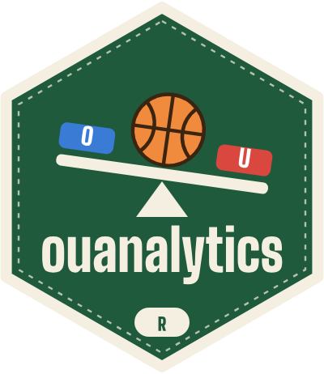
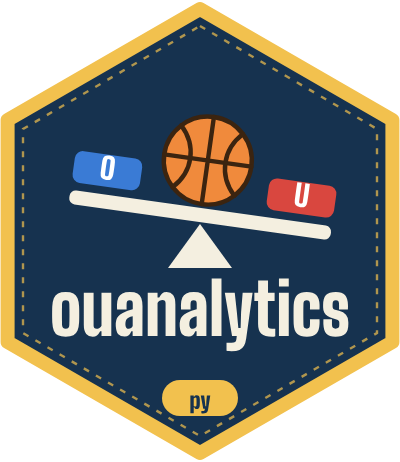

# ouanalytics

<p>
  
  
</p>

The calculations behind the **NBA over/under pool** page, written twice so each
can check the other: once in R, once in Python (polars). Not on CRAN or PyPI.

| | Language | What it is | Docs |
|---|---|---|---|
| [`r/`](r/) | R | Scores the picks, tracks each team against its win total, and seeds the playoffs with the official NBA tie-breakers. Tested at 100% line coverage. | <https://ismayc.github.io/ouanalytics/> |
| [`python/`](python/) | Python (polars) | An independent re-implementation that recomputes every table and compares it with R. Tested at 100% line and branch coverage. | [`python/README.md`](python/README.md) |
| [`golden/`](golden/) | CSV | Inputs and the tables R computes from them. Both test suites read these files. | |

The page build in [ismayc.github.io](https://github.com/ismayc/ismayc.github.io)
installs a **release tag** of both packages, so a push here cannot change a
build that has been working.

## Install a release

```r
remotes::install_github("ismayc/ouanalytics@v0.1.0", subdir = "r")
```

```sh
uvx --from "git+https://github.com/ismayc/ouanalytics@v0.1.0#subdirectory=python" ouanalytics-check --help
```

## How the two stay in step

1. R computes the tables. `Rscript r/tools/make-golden.R` writes them to `golden/`.
2. Python recomputes them from the same inputs. `cd python && uv run pytest` fails on any difference.
3. CI runs both, and re-runs step 1 to fail if `golden/` would change, so an R change cannot land without its golden files.

A difference means one language is wrong. Find out which before changing either.

## Layout

| Path | Contents |
|---|---|
| `r/` | The R package, its tests, and the pkgdown site sources |
| `python/` | The Python package and its tests |
| `golden/` | Shared test cases (`inputs/` and `outputs/` CSV files) |
| `branding/` | `make_branding.py` draws the logo, favicons, and link-preview images for both packages |
| `.github/workflows/` | `ci.yaml` (tests) and `pkgdown.yaml` (builds and publishes the site) |

## License

MIT. See [`LICENSE.md`](LICENSE.md).
